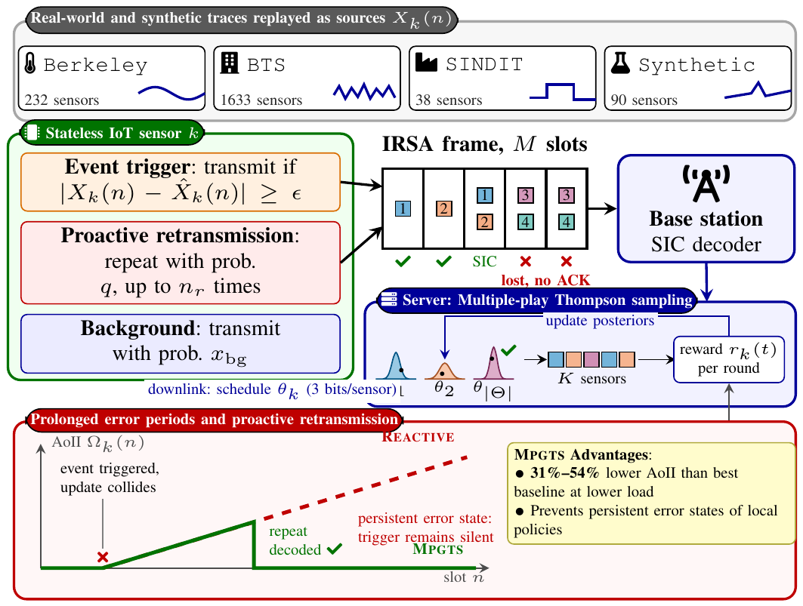
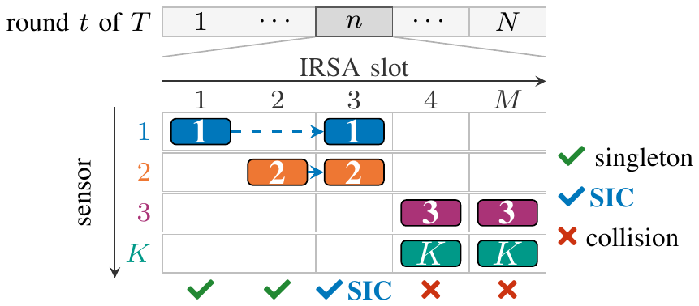

# An AoII Minimization Policy for IoT Sensor Traffic

Code of the paper of the same title.

Remote IoT sensors transmit status updates over a grant-free irregular repetition slotted ALOHA (IRSA) uplink without per-packet acknowledgements, and the server keeps an estimate of every sensor.
The age of incorrect information (AoII) measures how long and how far each estimate is wrong.
The sensors replay three public IoT datasets, `Berkeley`, `BTS` and `SINDIT`, and a `Synthetic` trace as ground truth.



**Fig. 1 of the paper.**
Each sensor follows an event trigger, performs proactive retransmissions with repeat probability $q$ up to a repeat budget $n_r$, and then transmits at a background rate $x_{\mathrm{bg}}$.
Without acknowledgements, an undetected collision leaves the server estimate stale until the source moves again.
The server learns the retransmission schedule $\theta_k = (q, n_r, x_{\mathrm{bg}})$ of every sensor by multiple-play Thompson sampling and broadcasts it once per learning round.



**Fig. 2 of the paper.**
Operations are structured into $T$ learning rounds of $N$ slots.
Each slot carries one IRSA frame of $M$ IRSA slots, in which every sensor that updates sends $L$ replicas on average.
The base station resolves singleton slots and cancels the other replicas of decoded packets by successive interference cancellation (SIC).

## Policies

| Code name | Paper name | Transmission rule |
|---|---|---|
| `reactive` | Reactive | transmits when the reading departs from the local estimate by at least $\epsilon$ |
| `threshold` | Threshold | transmits with probability $\rho$ once a local AoII proxy exceeds $\tau$ |
| `random` | Throughput | transmits at the throughput-maximizing rate $\overline{x}$ |
| `hybrid` | Hybrid | augments the event trigger with a fixed background rate sized to the leftover load |
| `ucb` | UCB | augments the event trigger with a background rate that each sensor learns by UCB1 |
| `vhct` | VHCT | augments the event trigger with a background rate that each sensor learns by VHCT |
| `mpgts` | MPGTS | event trigger, proactive retransmissions and background rate, with the retransmission schedule learned at the server |

The code names are the names under which the results are stored, and they differ from the paper only for Throughput.

## Directory structure

```
.
├── core              simulator and experiments; every make target runs here
│   ├── simulator     sensors, IRSA uplink and server
│   │   ├── normalizer    raw traces to one csv per sensor
│   │   └── solver        the seven policies and the learners of MPGTS
│   └── scenario      runs, data preparation, statistics and figures
│       ├── stat          summaries of the runs and Table I
│       └── plot          Figs. 3 and 4
├── lean              Lean 4 proofs of Theorem 1
├── test              tests that the code reproduces the paper
├── doc               Figs. 1 and 2 of the paper
└── data
    └── csv           summaries of the paper's results
        └── stat          slot intervals of the traces
```

`CLAUDE.md` holds the code style, the glossary from the paper notation to the code names, and the frozen names of the stored results.

## Installation

```bash
pip3 install -r requirement.txt
```

PyTorch is installed from the [PyTorch installation guide](https://pytorch.org/get-started/locally/).
The experiments ran on a Linux machine with an AMD Ryzen 9 5900X (12 cores, 24 threads) and 128 GB RAM, using Python 3.10, PyTorch 2.13, NumPy 2.2 and PyXAB 0.3.
Every simulation runs on the CPU.
The proofs need Lean 4 `v4.33.1` with Mathlib, as `lean/README.md` describes.

## Data

Every experiment reads the normalized traces in `data/data/<dataset>/`: one `<sensor_id>.csv` per sensor with columns `timestamp,value`, an `index.csv` and a `min_timestamp.txt`.
`make prepare` rebuilds them from the raw traces and overwrites `data/data/<dataset>/`.
The raw traces are not in this repository and are placed as follows.

| Dataset | Source | Raw layout |
|---|---|---|
| `Berkeley` | Intel Berkeley Research Lab sensor data, db.csail.mit.edu/labdata | `data/data/raw/berkeley/raw.csv` with columns `moteid,timestamp,temperature,humidity,light,voltage` |
| `BTS` | smart-building and environmental telemetry, Truong and Trang, IEEE Big Data 2022 | `data/data/raw/bts/raw.csv` with columns `station_id,parameter_id,reading_time,value` |
| `SINDIT` | industrial digital-twin telemetry, Nguyen et al., IEEE COMPSAC 2024 | `data/data/raw/sindit/<sensor>.csv`, one file per sensor with columns `time,value` |
| `Synthetic` | generated from a fixed seed by `make prepare` | none |

`make stat_dataset` reports the median inter-event time of each trace, which sets its slot interval in Section IV-A.

## Reproducing the paper

Each target runs its seeds in parallel and writes one csv per run to `data/csv/test/`, and its summary csv to `data/csv/`.
Simulations use ten seeds, `SEEDS=0..9`.
Every policy uses one setting on all traces.
The Threshold parameters $(\tau, \rho)$ are chosen once by `make threshold` on the first 40% of each run, disjoint from the last ten rounds that every result is scored on.

| Paper result | Command | Runs | Summary |
|---|---|---|---|
| Threshold parameters | `make threshold` | 320 | `threshold_tuning.csv` |
| Table I, RQ1 | `make run summary` | 280 | `summary.csv`, `wilcoxon.csv`, `figure/tab-main.tex` |
| Fig. 3, RQ2 ablation | `make ablation` | 400 | `ablation.csv` |
| RQ2 fixed schedules | `make fixed` | 320 | `fixed_schedules.csv`, `fixed_best.csv`, `fixed_worst.csv` |
| RQ3 parameter variations | `make causal frozen robustness subsets` | 3410 | `robustness.csv`, `subsets.csv` |
| Fig. 4, RQ3 scaling | `make scaling` | 280 | `scaling.csv`, `scaling_per_seed.csv` |
| Theorem 1 | `make proof` | | the axioms of every theorem |

The summaries in `data/csv/` are committed, so `make figures` regenerates Figs. 3 and 4 without rerunning any simulation.
`make results` regenerates every summary, Table I and Figs. 3 and 4 from the runs on disk.
`make paper` copies Table I and the figures into `../../paper/figure/` once `make test` passes.
`make all` runs `run` and `results`.
